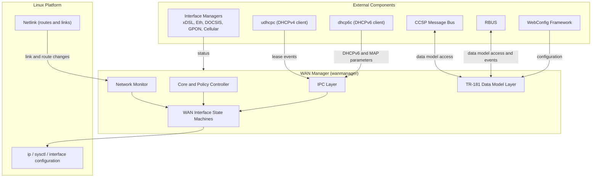
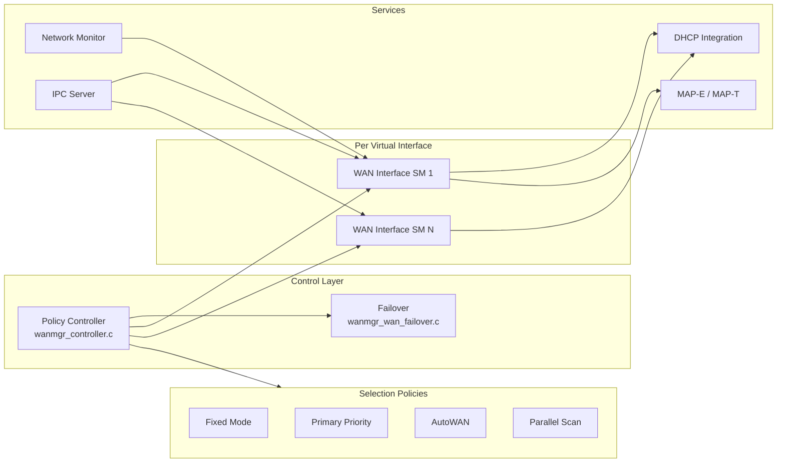
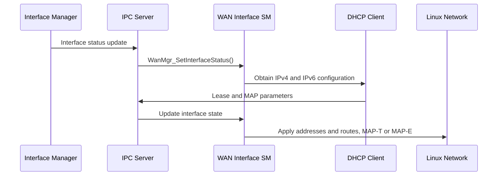

# WAN Manager Component Diagram

## Component Overview

WAN Manager is a single daemon process. Its core logic is split across a policy controller, one state machine per virtual WAN interface, a TR-181 data model layer, DHCP client integration, and an inter-process communication (IPC) layer.

WAN Manager does not bring up the physical layer. Interface managers for xDSL, Ethernet, DOCSIS, GPON, and Cellular report link status, and WAN Manager configures the link and IP layers on top of that status.

---

## System Context

---

## External Dependencies

| Dependency | Usage | Source Reference |
| ---------- | ----- | ---------------- |
| CCSP Message Bus | Component registration and TR-181 access | `source/WanManager/wanmgr_ssp_messagebus_interface.c` |
| RBUS | Data model access, WAN-ready event subscription | `source/TR-181/middle_layer_src/wanmgr_rbus_handler_apis.c` |
| WebConfig framework | Remote configuration | `source/WanManager/wanmgr_webconfig.c` |
| nanomsg | IPC transport (`nn_socket`, `nn_bind`, `nn_connect`) | `source/WanManager/wanmgr_ipc.c` |
| `udhcpc` | DHCPv4 client, started with `-p /tmp/udhcpc.<ifname>.pid` | `source/WanManager/wanmgr_dhcp_legacy_apis.c` |
| `dhcp6c` | DHCPv6 client, sent `SIGUSR2` to request renewal | `source/WanManager/wanmgr_ipc.c` |
| Netlink (`NETLINK_ROUTE`) | Link and route change monitoring | `source/WanManager/wanmgr_network_monitor.c` |
| `secure_wrapper` | Executes system commands (`v_secure_system`) | `source/WanManager/Makefile.am` |
| `rdkloggers` | Logging, configured by `/etc/debug.ini` | `source/WanManager/wanmgr_main.c` |
| `systemd` (optional) | `sd_notify` readiness signal | `configure.ac` (`--enable-notify`) |

---

## High-Level Architecture

---

## Component Responsibilities

| Component | Responsibility | Documentation |
| --------- | -------------- | ------------- |
| Policy Controller | Initialises the state machines and applies the selected WAN policy | [controller.md](../components/controller.md) |
| WAN Interface State Machine | Tracks each virtual interface through the `eWanState_t` states | [interface-state-machine.md](../components/interface-state-machine.md) |
| Data Model Layer | Implements the `Device.X_RDK_WanManager.*` TR-181 objects and WebConfig | [data-model-layer.md](../components/data-model-layer.md) |
| DHCP Clients | Handles DHCPv4 and DHCPv6 lease events and MAP parameters | [dhcp-clients.md](../components/dhcp-clients.md) |
| IPC and Network Monitor | Receives status messages and kernel link and route changes | [ipc.md](../components/ipc.md) |
| SSP | Process start-up, message bus engagement, and command dispatch | [ssp.md](../components/ssp.md) |

---

## Data Flow

---

## WAN Interface State Machine

Each virtual WAN interface has a state machine whose current state is stored as `eCurrentState` of type `eWanState_t`. The states are defined in `source/TR-181/include/wanmgr_dml.h`:

| State | Purpose in the sequence |
| ----- | ----------------------- |
| `WAN_STATE_EXIT` | Exit state |
| `WAN_STATE_PHY_CONFIGURING` | Physical layer configuration |
| `WAN_STATE_PHY_DOWN` | Physical layer is down |
| `WAN_STATE_VLAN_CONFIGURING` | VLAN interface configuration |
| `WAN_STATE_PPP_CONFIGURING` | PPP configuration |
| `WAN_STATE_VALIDATING_WAN` | WAN validation |
| `WAN_STATE_OBTAINING_IP_ADDRESSES` | IP address acquisition |
| `WAN_STATE_IPV4_LEASED` | IPv4 lease obtained |
| `WAN_STATE_IPV6_LEASED` | IPv6 lease obtained |
| `WAN_STATE_DUAL_STACK_ACTIVE` | IPv4 and IPv6 active |
| `WAN_STATE_MAP_ACTIVE` | MAP transport active |
| `WAN_STATE_REFRESHING_WAN` | WAN refresh |
| `WAN_STATE_DECONFIGURING_WAN` | WAN teardown |
| `WAN_STATE_STANDBY` | Standby |

The transition logic is implemented in `source/WanManager/wanmgr_interface_sm.c`. See [interface-state-machine.md](../components/interface-state-machine.md) for details.

---

## Error Handling

| Condition | Behaviour | Source |
| --------- | --------- | ------ |
| Component start-up before the system is ready | Waits up to 180 seconds for `wan_ready_to_go` | `wanmgr_main.c` |
| Failed `Cdm_Init` | Process exits with status 1 | `wanmgr_main.c` |
| Failed IPC socket creation or bind | Error is logged | `wanmgr_ipc.c` |
| Failed IPC send | Retried up to 5 times, 100 ms apart | `wanmgr_ipc.c` |
| Previous crash detected | Reported to the WebConfig framework | `wanmgr_main.c` (`check_component_crash`) |

---

## Security Architecture

- The process drops root capabilities at start-up when the non-root feature is enabled (`init_capability`, `drop_root_caps`, `clear_caps`).
- Shell commands are issued through `v_secure_system` from the `secure_wrapper` library.
- The TR-181 `Policy` parameter is read-only when the `WANMGR_POLICY_TR181_READONLY` condition is set in the data model XML.

---

## Build Variants

| Variant | Configure Option | Effect |
| ------- | ---------------- | ------ |
| Default | none | `wanmgr_policy_autowan_impl.c` is built |
| WAN unification | `--enable-wanunificationsupport` | Sets `WAN_UNIFICATION_ENABLED`; `dhcpv6c_msg_apis.c` is built if DHCP manager is disabled |
| DHCP manager | `--enable-dhcp_manager` | Sets `DHCPMANAGER_ENABLED`; `wanmgr_dhcp_event_handler.c` is built |
| systemd notify | `--enable-notify` | Sets `ENABLE_SD_NOTIFY`; links `systemd` |
| Unit tests | `--enable-gtestapp` | Sets `GTEST_ENABLE` |
