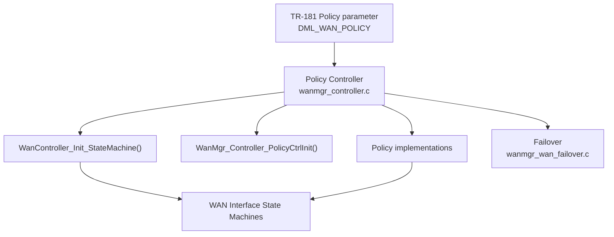
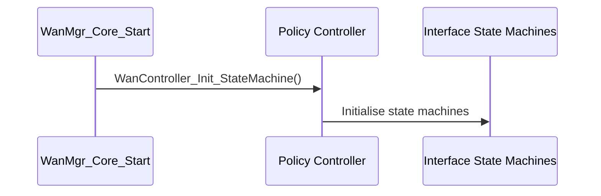

# Policy Controller

## Overview

The policy controller decides which WAN interface is active. It initialises the WAN Interface State Machines and applies the WAN selection policy configured through the `Policy` parameter of `Device.X_RDK_WanManager.*`.

Source files:

- `source/WanManager/wanmgr_controller.c`
- `source/WanManager/wanmgr_controller.h`

---

## Architecture

---

## Key Components

| Type | Path | Purpose |
| ---- | ---- | ------- |
| Controller | `source/WanManager/wanmgr_controller.c` | Controller initialisation and policy entry points |
| Controller header | `source/WanManager/wanmgr_controller.h` | Policy controller structure and function declarations |
| Failover | `source/WanManager/wanmgr_wan_failover.c` | Switching between interface groups |
| AutoWAN implementation | `source/WanManager/wanmgr_policy_autowan_impl.c` | AutoWAN selection (built when WAN unification is disabled) |
| Policy implementations | `source/WanManager/wanmgr_policy_*_impl.c` | Per-policy selection logic (see table below) |

### Policy Implementation Files

The implementation files are named after the policy they serve. The file-to-policy mapping below is based on the file names.

| File | Policy file suffix | Policy value |
| ---- | ------------------ | ------------ |
| `wanmgr_policy_fmob_impl.c` | `fmob` | `FIXED_MODE_ON_BOOTUP` |
| `wanmgr_policy_fm_impl.c` | `fm` | `FIXED_MODE` |
| `wanmgr_policy_ppob_impl.c` | `ppob` | `PRIMARY_PRIORITY_ON_BOOTUP` |
| `wanmgr_policy_pp_impl.c` | `pp` | `PRIMARY_PRIORITY` |
| `wanmgr_policy_auto_impl.c` | `auto` | AutoWAN-related selection (exact mapping not confirmed in source) |
| `wanmgr_policy_autowan_impl.c` | `autowan` | AutoWAN (built when WAN unification is disabled) |
| `wanmgr_policy_parallel_scan_impl.c` | `parallel_scan` | `PARALLEL_SCAN` |

---

## Core Functions

### WanController_Init_StateMachine

**Purpose:** Initialises the WAN Interface State Machines through the controller.

| | |
| - | - |
| **Inputs** | None |
| **Outputs** | `ANSC_STATUS` |
| **Called by** | `WanMgr_Core_Start()` in `source/WanManager/wanmgr_core.c` |

### WanMgr_Controller_PolicyCtrlInit

**Purpose:** Initialises the policy controller structure.

| | |
| - | - |
| **Inputs** | `WanMgr_Policy_Controller_t* pWanPolicyCtrl` |
| **Outputs** | `ANSC_STATUS` |

### WanMgr_Policy_AutoWan and WanMgr_Policy_AutoWanPolicy

**Purpose:** AutoWAN policy entry points declared in `wanmgr_controller.h`.

| | |
| - | - |
| **Inputs** | None |
| **Outputs** | `ANSC_STATUS` |

The fixed-mode and primary-priority entry points are declared in a commented-out block in `wanmgr_controller.h`. They are not active declarations in this header.

---

## Data Structures

The policy controller state is held in `WanMgr_Policy_Controller_t`, defined in `source/WanManager/wanmgr_controller.h`. The fields used by the controller include:

| Field | Meaning |
| ----- | ------- |
| `activeInterfaceIdx` | Index of the active interface |
| `selSecondaryInterfaceIdx` | Index of the selected secondary interface |
| `pWanActiveIfaceData` | Pointer to the active interface data |
| `SelectionTimeOutStart`, `SelectionTimeOutEnd` | Interface selection timing |
| `InterfaceSelectionTimeOut` | Configured selection timeout |
| `TotalIfaces` | Number of interfaces in the group |
| `WanOperationalMode` | Current operational mode |
| `GroupCfgChanged` | Set when group configuration changes |
| `ResetSelectedInterface` | Reset flag for the selected interface |
| `AllowRemoteInterfaces` | Whether remote interfaces are allowed |
| `GroupIfaceList`, `GroupInst` | Interface group membership |

---

## Policy Values

The `Policy` parameter maps to `DML_WAN_POLICY` in `source/TR-181/include/wanmgr_dml.h`.

| Value | Name |
| ----- | ---- |
| 1 | `FIXED_MODE_ON_BOOTUP` |
| 2 | `FIXED_MODE` |
| 3 | `PRIMARY_PRIORITY_ON_BOOTUP` |
| 4 | `PRIMARY_PRIORITY` |
| 5 | `MULTIWAN_MODE` |
| 6 | `AUTOWAN_MODE` |
| 7 | `PARALLEL_SCAN` |

---

## Processing Flow

The policy selected through the `Policy` parameter is applied by the implementation files listed above. The detailed selection sequence for each policy is implemented in those files.

---

## Integration Points

### Dependencies

| Component | Usage |
| --------- | ----- |
| Interface State Machine | Started and updated by the controller (see [interface-state-machine.md](interface-state-machine.md)) |
| Data Model Layer | Source of the `Policy` and group configuration (see [data-model-layer.md](data-model-layer.md)) |
| Failover | Group switching (`wanmgr_wan_failover.c`) |

### Consumers

| Component | Usage |
| --------- | ----- |
| WAN Manager core | Calls `WanController_Init_StateMachine()` from `WanMgr_Core_Start()` |
