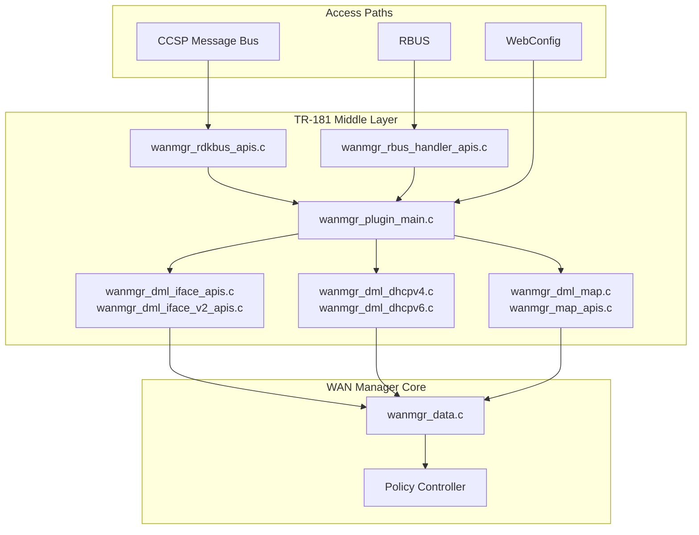
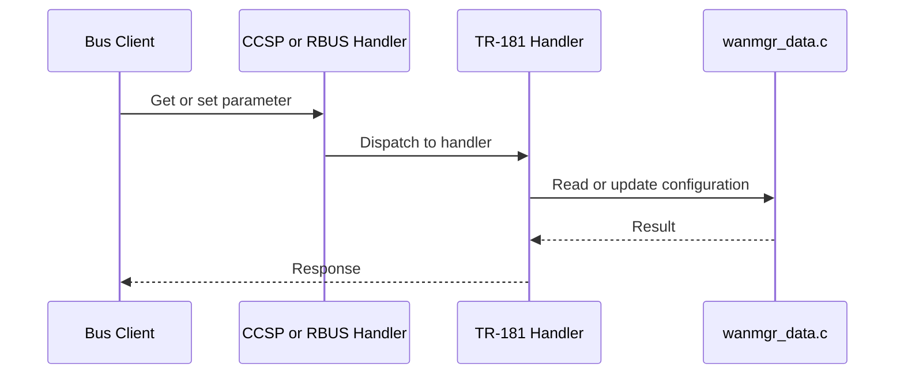

# Data Model Layer

## Overview

The data model layer implements the TR-181 `Device.X_RDK_WanManager.*` subtree. It exposes WAN Manager configuration and status to the message bus and RBUS, and it holds the in-memory interface, group, and policy data that the other components use.

Source files:

- `source/TR-181/middle_layer_src/` (TR-181 handlers)
- `source/TR-181/include/wanmgr_dml.h` (enums and structures)
- `source/WanManager/wanmgr_data.c` and `wanmgr_data.h` (data initialisation and management)
- `config/RdkWanManager.xml`, `config/RdkWanManager_v2.xml` (data model definitions)

---

## Architecture

---

## Key Components

| Type | Path | Purpose |
| ---- | ---- | ------- |
| Plugin main | `source/TR-181/middle_layer_src/wanmgr_plugin_main.c` | Registers the TR-181 data model handlers |
| Interface APIs | `source/TR-181/middle_layer_src/wanmgr_dml_iface_apis.c`, `wanmgr_dml_iface_v2_apis.c` | `X_RDK_WanManager` interface objects |
| DHCP APIs | `source/TR-181/middle_layer_src/wanmgr_dml_dhcpv4.c`, `wanmgr_dml_dhcpv6.c` | DHCPv4 and DHCPv6 data model objects |
| MAP APIs | `source/TR-181/middle_layer_src/wanmgr_dml_map.c`, `wanmgr_map_apis.c` | MAP-T and MAP-E data model objects |
| RBUS handler | `source/TR-181/middle_layer_src/wanmgr_rbus_handler_apis.c` | RBUS data model access and event subscription |
| Message bus handler | `source/TR-181/middle_layer_src/wanmgr_rdkbus_apis.c` | CCSP message bus data model access |
| WebConfig | `source/WanManager/wanmgr_webconfig.c`, `source/TR-181/include/wanmgr_webconfig_apis.h` | Remote configuration |
| Data management | `source/WanManager/wanmgr_data.c` | Data initialisation, release, and interface configuration |

---

## Core Functions

### WanMgr_Data_Init

**Purpose:** Initialises WAN Manager data. Called at the start of `main()` before the process daemonises.

| | |
| - | - |
| **Inputs** | None |
| **Outputs** | None |

### WanMgr_WanDataInit

**Purpose:** Initialises the WAN data structures.

| | |
| - | - |
| **Inputs** | None |
| **Outputs** | `ANSC_STATUS` |

### WanMgr_SetConfigData_Default

**Purpose:** Sets the default WAN Manager configuration.

| | |
| - | - |
| **Inputs** | `DML_WANMGR_CONFIG* pWanDmlConfig` |
| **Outputs** | None |

### WanMgr_IfaceData_Init

**Purpose:** Initialises the data for one interface instance.

| | |
| - | - |
| **Inputs** | `WanMgr_Iface_Data_t* pIfaceData`, `UINT uiInstNumber` |
| **Outputs** | None |

### WanMgr_UpdatePrevData

**Purpose:** Updates the previous-data snapshot. Called from `WanMgr_Core_Start()`.

| | |
| - | - |
| **Inputs** | None |
| **Outputs** | `ANSC_STATUS` |

---

## Data Structures

### Policy Enum

`DML_WAN_POLICY` in `wanmgr_dml.h`:

| Value | Name |
| ----- | ---- |
| 1 | `FIXED_MODE_ON_BOOTUP` |
| 2 | `FIXED_MODE` |
| 3 | `PRIMARY_PRIORITY_ON_BOOTUP` |
| 4 | `PRIMARY_PRIORITY` |
| 5 | `MULTIWAN_MODE` |
| 6 | `AUTOWAN_MODE` |
| 7 | `PARALLEL_SCAN` |

### Other Enums

| Enum | Purpose |
| ---- | ------- |
| `DML_WAN_IP_MODE` | `IPV4_ONLY`, `IPV6_ONLY`, `DUAL_STACK`, `NO_IP` |
| `VLAN_DISCOVERY_MODE` | `VLAN_DISCOVERY_MODE_ALWAYS` (discover on every boot), `VLAN_DISCOVERY_MODE_ONCE` (discover only if no VLANs were found previously) |
| `DML_MAP_TRANSPORT` | MAP transport type |
| `DML_MAP_STATUS` | MAP status |
| `DML_WAN_IFACE_TYPE` | Interface type |
| `DML_WAN_IFACE_STATUS` | Interface status |

The complete list is in `source/TR-181/include/wanmgr_dml.h`.

---

## Data Model Objects

The root object is `Device.X_RDK_WanManager.`. Parameters below are taken from the data model XML files.

| Parameter | Type | Notes |
| --------- | ---- | ----- |
| `Enable` | boolean | Writable |
| `Data` | string | Writable |
| `Policy` | enum (`DML_WAN_POLICY`) | Writable unless `WANMGR_POLICY_TR181_READONLY` is set |
| `AllowRemoteInterfaces` | boolean | Present in `RdkWanManager.xml` and `RdkWanManager_v2.xml` |
| `Version` | string | Present in `RdkWanManager_v2.xml` only |

The XML files also define MAP parameters (`MapTransportMode`, `MapBRPrefix`, `MapRuleIPv4Prefix`, `MapRuleIPv6Prefix`, `MapEALen`, `MapPSIDOffset`, `MapPSIDLen`, `MapPSID`, `MapIsFMR`, `MapIpv4Address`, `MapRatio`). See [configuration-guide.md](../configuration-guide.md).

---

## Processing Flow

---

## Integration Points

### Dependencies

| Component | Usage |
| --------- | ----- |
| CCSP Message Bus | Parameter access (`wanmgr_rdkbus_apis.c`) |
| RBUS | Parameter access and WAN-ready subscription (`wanmgr_rbus_handler_apis.c`) |
| WebConfig | Configuration updates (`wanmgr_webconfig.c`) |

### Consumers

| Component | Usage |
| --------- | ----- |
| Policy Controller | Reads `Policy` and group configuration |
| Interface State Machines | Read interface configuration |

---

## Error Handling

| Condition | Behaviour |
| --------- | --------- |
| Failed data model initialisation | `Cdm_Init` failure causes the process to exit with status 1 (`wanmgr_main.c`) |
