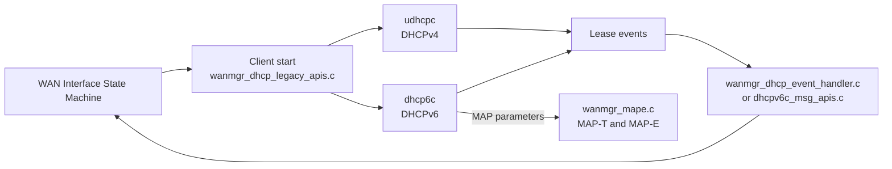
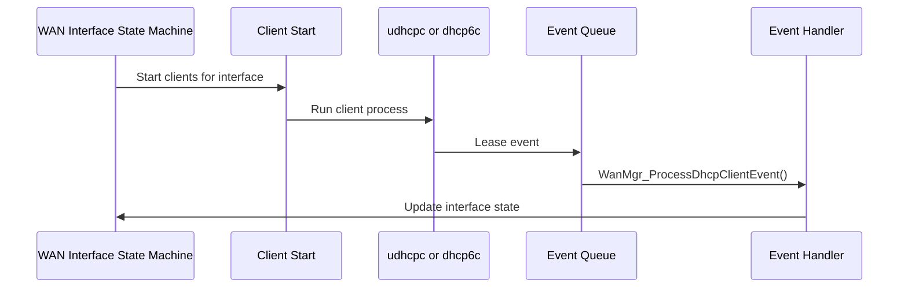

# DHCP Clients

## Overview

WAN Manager obtains IPv4 and IPv6 configuration by running external DHCP clients and processing their results. The DHCPv4 client is `udhcpc`. The DHCPv6 client is `dhcp6c`. WAN Manager starts the clients, receives their lease events, and applies the resulting addresses, routes, and MAP parameters to the WAN interface.

Source files:

- `source/WanManager/wanmgr_dhcpv4_apis.c`, `wanmgr_dhcpv4_internal.c` (DHCPv4)
- `source/WanManager/wanmgr_dhcpv6_apis.c`, `wanmgr_dhcpv6_internal.c` (DHCPv6)
- `source/WanManager/wanmgr_dhcp_legacy_apis.c` (client start and legacy handling)
- `source/WanManager/wanmgr_dhcp_event_handler.c` (lease event processing)
- `source/WanManager/wanmgr_dhcp_client_events.h` (event queue declarations)
- `source/TR-181/middle_layer_src/wanmgr_rbus_dhcp_client_events.c` (event queue implementation)
- `source/WanManager/DHCPv6cMsgHandler/dhcpv6c_msg_apis.c` (DHCPv6 message handling, when WAN unification is enabled and DHCP manager is not)

---

## Architecture

---

## Key Components

| Type | Path | Purpose |
| ---- | ---- | ------- |
| DHCPv4 APIs | `source/WanManager/wanmgr_dhcpv4_apis.c` | DHCPv4 client configuration and status |
| DHCPv4 internals | `source/WanManager/wanmgr_dhcpv4_internal.c` | DHCPv4 helper logic |
| DHCPv6 APIs | `source/WanManager/wanmgr_dhcpv6_apis.c` | DHCPv6 client configuration and status |
| DHCPv6 internals | `source/WanManager/wanmgr_dhcpv6_internal.c` | DHCPv6 helper logic |
| Legacy APIs | `source/WanManager/wanmgr_dhcp_legacy_apis.c` | Client start, interface and route setup |
| Event handler | `source/WanManager/wanmgr_dhcp_event_handler.c` | Processes lease events |
| Event queue | `source/WanManager/wanmgr_dhcp_client_events.h`, `source/TR-181/middle_layer_src/wanmgr_rbus_dhcp_client_events.c` | Queues and dispatches DHCP client events |
| DHCPv6 message handler | `source/WanManager/DHCPv6cMsgHandler/dhcpv6c_msg_apis.c` | DHCPv6 message handling |

---

## Core Functions

### WanMgr_DhcpEventQueue_Enqueue

**Purpose:** Adds a DHCP client event to the queue for processing.

| | |
| - | - |
| **Inputs** | `DhcpEventThreadArgs *eventData` |
| **Outputs** | None |

### WanMgr_ProcessDhcpClientEvent

**Purpose:** Processes one DHCP client event.

| | |
| - | - |
| **Inputs** | `DhcpEventThreadArgs *eventData` |
| **Outputs** | None |

### WanManager_AddDefaultGatewayRoute

**Purpose:** Adds the default gateway route for an IPv4 configuration (`wanmgr_net_utils.h`).

| | |
| - | - |
| **Inputs** | `DEVICE_NETWORKING_MODE DeviceNwMode`, `const WANMGR_IPV4_DATA* ipv4Info` |
| **Outputs** | `int` status |

### WanManager_send_and_receive_rs, WanManager_SendRS_And_ProcessRA

**Purpose:** Send IPv6 router solicitation and process the router advertisement (`wanmgr_net_utils.h`).

| | |
| - | - |
| **Inputs** | `DML_VIRTUAL_IFACE *pVirtIf` |
| **Outputs** | `int` status (`WanManager_send_and_receive_rs`) or `ANSC_STATUS` (`WanManager_SendRS_And_ProcessRA`) |

---

## Client Details

### DHCPv4 (udhcpc)

| Item | Value | Source |
| ---- | ----- | ------ |
| Client name | `udhcpc` (`DHCPV4_CLIENT_NAME`) | `wanmgr_dhcpv4_apis.h` |
| Action handler | `service_udhcpc` (`DHCPV4_ACTION_HANDLER`) | `wanmgr_dhcpv4_apis.h` |
| Start command | `/sbin/udhcpc -b -i <ifname> -p /tmp/udhcpc.<ifname>.pid -O 121 -s /etc/udhcpc_vlan.script`, with optional `-x hostname:<name>` and `-V <vendor class>` arguments depending on the build and configuration | `wanmgr_dhcp_legacy_apis.c` |
| PID file | `/tmp/udhcpc.<ifname>.pid` | `wanmgr_dhcp_legacy_apis.c` |

### DHCPv6 (dhcp6c)

| Item | Behaviour | Source |
| ---- | --------- | ------ |
| Renewal | `SIGUSR2` is sent to `dhcp6c` (via `killall` or `util_signalProcess`) so it sends a renew packet | `wanmgr_dhcpv6_apis.c`, `wanmgr_ipc.c` |
| MAP parameters | Stored in `pVirtIf->MAP.dhcp6cMAPparameters` (type `ipc_map_data_t`) and used for MAP-E or MAP-T | `wanmgr_dml.h`, `wanmgr_dhcp_event_handler.c` |

---

## Processing Flow

---

## Integration Points

### Dependencies

| Component | Usage |
| --------- | ----- |
| `udhcpc` | DHCPv4 client process |
| `dhcp6c` | DHCPv6 client process |
| `secure_wrapper` | Client start and route commands (`v_secure_system`) |
| MAP-T and MAP-E (`wanmgr_mape.c`, `wanmgr_net_utils.c`) | Consume MAP parameters from DHCPv6 |

### Consumers

| Component | Usage |
| --------- | ----- |
| WAN Interface State Machine | Receives lease results (see [interface-state-machine.md](interface-state-machine.md)) |

---

## Error Handling

| Condition | Behaviour | Source |
| --------- | --------- | ------ |
| Renewal request to `dhcp6c` | A trace line is logged before `SIGUSR2` is sent | `wanmgr_ipc.c` |
