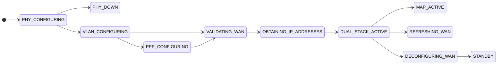
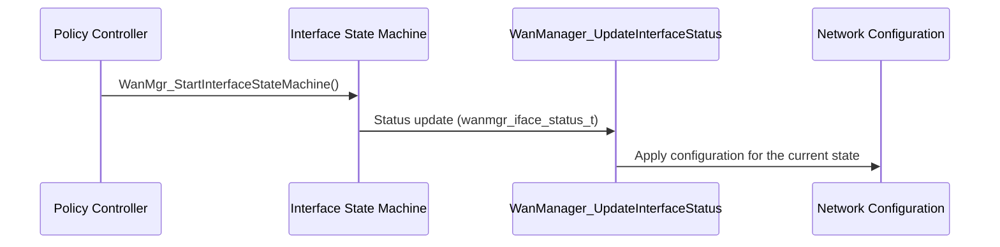

# WAN Interface State Machine

## Overview

Each virtual WAN interface has its own WAN Interface State Machine. The state machine tracks the interface through the WAN lifecycle, from physical configuration to an active IPv4 and IPv6 connection, and processes status updates for that interface.

Source files:

- `source/WanManager/wanmgr_interface_sm.c`
- `source/WanManager/wanmgr_interface_sm.h`
- `source/WanManager/wanmgr_interface_apis.c`
- `source/WanManager/wanmgr_interface_apis.h`

---

## Architecture

The diagram shows the main path through the states defined in `eWanState_t`. It is a simplified view. Use `wanmgr_interface_sm.c` for the exact transition conditions.

---

## Key Components

| Type | Path | Purpose |
| ---- | ---- | ------- |
| State machine | `source/WanManager/wanmgr_interface_sm.c` | State transitions and status handling |
| State machine header | `source/WanManager/wanmgr_interface_sm.h` | Status enum, controller structure, function declarations |
| Interface APIs | `source/WanManager/wanmgr_interface_apis.c` | Start, stop, activate, and deactivate interface operations |

---

## Core Functions

### WanMgr_IfaceSM_Init

**Purpose:** Initialises the state machine controller for one virtual interface.

| | |
| - | - |
| **Inputs** | `WanMgr_IfaceSM_Controller_t* pWanIfaceSMCtrl`, `INT iface_idx`, `INT VirIfIdx` |
| **Outputs** | None |

### WanMgr_StartInterfaceStateMachine

**Purpose:** Starts the state machine for an interface.

| | |
| - | - |
| **Inputs** | `WanMgr_IfaceSM_Controller_t *wanIf` |
| **Outputs** | `int` status |

### WanManager_UpdateInterfaceStatus

**Purpose:** Applies a status update to a virtual interface.

| | |
| - | - |
| **Inputs** | `DML_VIRTUAL_IFACE* pVirtIf`, `wanmgr_iface_status_t iface_status` |
| **Outputs** | None |

### WanMgr_StartWanVISM, WanMgr_StopWanVISM

**Purpose:** Start and stop the WAN Interface State Machine for a virtual interface index (`wanmgr_interface_apis.h`).

| | |
| - | - |
| **Inputs** | `int interfaceIndex`, and `WANMGR_IFACE_SELECTION selectionStatus` for start |
| **Outputs** | `int` status |

### WanMgr_ActivateInterface, WanMgr_DeactivateInterface

**Purpose:** Activate or deactivate an interface (`wanmgr_interface_apis.h`).

| | |
| - | - |
| **Inputs** | `int interfaceIndex` |
| **Outputs** | `int` status |

---

## Data Structures

### Interface Status Values

`wanmgr_iface_status_t` in `wanmgr_interface_sm.h` describes the status updates a state machine accepts.

| Value | Meaning |
| ----- | ------- |
| `WANMGR_IFACE_LINK_UP` | Link is up |
| `WANMGR_IFACE_LINK_DOWN` | Link is down |
| `WANMGR_IFACE_CONNECTION_UP` | IPv4 connection is up |
| `WANMGR_IFACE_CONNECTION_DOWN` | IPv4 connection is down |
| `WANMGR_IFACE_CONNECTION_IPV6_UP` | IPv6 connection is up |
| `WANMGR_IFACE_CONNECTION_IPV6_DOWN` | IPv6 connection is down |
| `WANMGR_IFACE_MAPT_START` | MAP-T start |
| `WANMGR_IFACE_MAPT_STOP` | MAP-T stop |
| `WANMGR_IFACE_MAPE_START` | MAP-E start |
| `WANMGR_IFACE_MAPE_STOP` | MAP-E stop |
| `WANMGR_IFACE_STATUS_ERROR` | Error status |

### WanMgr_IfaceSM_Ctrl_st

The controller structure `WanMgr_IfaceSM_Controller_t` holds:

| Field | Meaning |
| ----- | ------- |
| `WanEnable` | Interface enable flag |
| `interfaceIdx` | Interface index |
| `VirIfIdx` | Virtual interface index |
| `IhcPid`, `IhcV4Status`, `IhcV6Status` | IPOE health check process and status (when `FEATURE_IPOE_HEALTH_CHECK` is defined) |
| `pIfaceData` | Pointer to the interface data (`DML_WAN_IFACE`) |
| `eCurrentState` | Current state (`eWanState_t`) |
| `DeviceNwMode` | Device networking mode |
| `DeviceNwModeChanged` | Set when the networking mode changes and configuration must be applied |

### WAN States

The states are listed in the [component diagram](../architecture/component-diagram.md#wan-interface-state-machine).

---

## Processing Flow

---

## Integration Points

### Dependencies

| Component | Usage |
| --------- | ----- |
| Data Model Layer | Interface data (`DML_VIRTUAL_IFACE`, `DML_WAN_IFACE`) |
| DHCP Clients | Lease results used to advance the state (see [dhcp-clients.md](dhcp-clients.md)) |
| IPC | Status updates through `WanMgr_SetInterfaceStatus()` (see [ipc.md](ipc.md)) |

### Consumers

| Component | Usage |
| --------- | ----- |
| Policy Controller | Starts and stops state machines (see [controller.md](controller.md)) |
