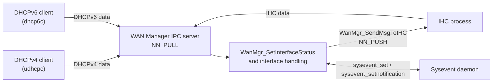
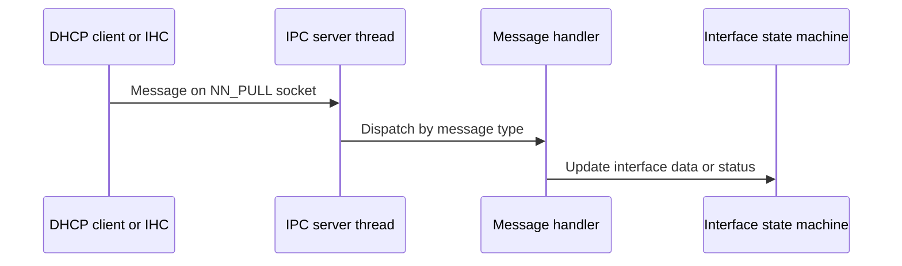

# IPC and Sysevent

## Overview

WAN Manager exchanges messages with other processes through two mechanisms:

- **nanomsg IPC** (`wanmgr_ipc.c`): WAN Manager runs a server socket that receives DHCP, DHCPv6, and IHC (IPoE health check) messages. It also pushes messages to the IHC process.
- **Sysevent** (`wanmgr_sysevents.c`): WAN Manager publishes WAN connection state and DNS/gateway values as sysevent tuples, and subscribes to sysevent notifications that affect WAN state.

Source files:

- `source/WanManager/wanmgr_ipc.c`, `wanmgr_ipc.h`
- `source/WanManager/wanmgr_sysevents.c`, `wanmgr_sysevents.h`

---

## Architecture

---

## Key Components

| Item | Source | Purpose |
| ---- | ------ | ------- |
| IPC server thread | `wanmgr_ipc.c` (`IpcServerThread`) | Receives messages on an `NN_PULL` socket bound to `WAN_MANAGER_ADDR` |
| `WanMgr_StartIpcServer` | `wanmgr_ipc.c` | Starts the IPC server |
| `WanMgr_SendMsgToIHC` | `wanmgr_ipc.c` | Sends an IHC message on an `NN_PUSH` socket connected to `IHC_IPC_ADDR` |
| `WanMgr_SetInterfaceStatus` | `wanmgr_ipc.c` | Sets the status of a named WAN interface |
| `Wan_ForceRenewDhcpIPv4`, `Wan_ForceRenewDhcpIPv6` | `wanmgr_ipc.c` | Trigger DHCP renewal for an interface |
| `WanMgr_SyseventInit` | `wanmgr_sysevents.c` | Opens the sysevent send and receive connections |
| `WanMgr_SyseventClose` | `wanmgr_sysevents.c` | Closes the sysevent connections |

---

## IPC Messages

The IPC server handles these message types in `wanmgr_ipc.c`:

| Message | Handler | Effect |
| ------- | ------- | ------ |
| DHCPv4 data (`ipc_dhcpv4_data_t`) | `WanMgr_IpcNewIpv4Msg` | Processes new IPv4 lease data |
| DHCPv6 data (`ipc_dhcpv6_data_t`) | `WanMgr_IpcNewIpv6Msg` | Processes new IPv6 lease data, including MAP parameters |
| IHC data (`ipc_ihc_data_t`) | `WanMgr_IpcNewIhcMsg` | Processes IPoE health check data |

Messages sent to the IHC process (`WanMgr_SendMsgToIHC`) carry a message type (`ipoe_msg_type_t`), the interface name, and one of the following:

- `IPOE_MSG_WAN_CONNECTION_UP`: the IPv4 address of the interface and the `ntp_server1` value from syscfg
- `IPOE_MSG_WAN_CONNECTION_IPV6_UP`: the IPv6 address of the interface and the `ntp_server1` value from syscfg

---

## Renewal Signals

To renew a DHCPv6 lease, WAN Manager sends `SIGUSR2` to `dhcp6c`. The signal is sent through `util_signalProcess` in `wanmgr_ipc.c` and through `killall -SIGUSR2` in `wanmgr_dhcpv6_apis.c`. The signal tells `dhcp6c` to send a renew packet.

WAN Manager also installs a `SIGUSR2` handler in `wanmgr_main.c` that logs the signal.

---

## Sysevent

WAN Manager opens two sysevent connections in `WanMgr_SyseventInit`: one for sending and one for receiving notifications. The connection names are `WANMGR_SYSNAME_SND` and `WANMGR_SYSNAME_RCV`.

### Published Tuples

WAN Manager sets sysevent tuples to report WAN state. Examples from `wanmgr_sysevents.c` and `wanmgr_ipc.c`:

| Tuple | Written value | Source |
| ----- | ------------- | ------ |
| `SYSEVENT_IPV4_CONNECTION_STATE` | `WAN_STATUS_UP` when the IPv4 connection is established | `wanmgr_ipc.c` |
| `SYSEVENT_IPV6_CONNECTION_STATE` | `WAN_STATUS_UP` when the IPv6 connection is established; `WAN_STATUS_DOWN` at initialisation | `wanmgr_ipc.c`, `wanmgr_sysevents.c` |
| `SYSEVENT_IPV6_STATUS` | `"down"` at initialisation | `wanmgr_sysevents.c` |
| `SYSEVENT_FIELD_IPV6_DOMAIN` | Empty string at initialisation | `wanmgr_sysevents.c` |

### Subscribed Notifications

WAN Manager registers for event notifications with `sysevent_setnotification`. Examples:

| Tuple | Purpose |
| ----- | ------- |
| `SYSEVENT_BRIDGE_STATUS` | Bridge status changes |
| `SYSEVENT_MULTINET1_STATUS` | Multinet status changes |
| `SYSEVENT_IPV4_GATEWAY` | IPv4 gateway changes |
| `SYSEVENT_IPV4_DNS` | IPv4 DNS changes |
| `SYSEVENT_IPV6_DNS` | IPv6 DNS changes |
| `SYSEVENT_BACKUP_IPv4_DNS` | Backup IPv4 DNS changes |

---

## Processing Flow

---

## Integration Points

### Dependencies

| Component | Usage |
| --------- | ----- |
| nanomsg (`nn_socket`, `nn_bind`, `nn_connect`) | Transport for IPC messages |
| Sysevent (`sysevent_open`, `sysevent_set`, `sysevent_setnotification`) | WAN state publication and notifications |
| `dhcp6c` | Receives `SIGUSR2` for renewal |

### Consumers

| Component | Usage |
| --------- | ----- |
| WAN Interface State Machine | Receives IPC data and status changes (see [interface-state-machine.md](interface-state-machine.md)) |
| DHCP clients | See [dhcp-clients.md](dhcp-clients.md) |

---

## Error Handling

| Condition | Behaviour | Source |
| --------- | --------- | ------ |
| `nn_socket` fails on the IPC server | Error is logged and the server thread returns | `wanmgr_ipc.c` |
| `nn_bind` fails on `WAN_MANAGER_ADDR` | Socket is closed, the thread waits 5 seconds, and bind is retried | `wanmgr_ipc.c` |
| IHC socket creation, connect, or send fails | Error is logged, the socket is closed, and `ANSC_STATUS_FAILURE` is returned. No retry is performed in this function | `wanmgr_ipc.c` |
| `syscfg_get("ntp_server1")` fails while building an IHC message | Error is logged and the message is sent without a domain name | `wanmgr_ipc.c` |
