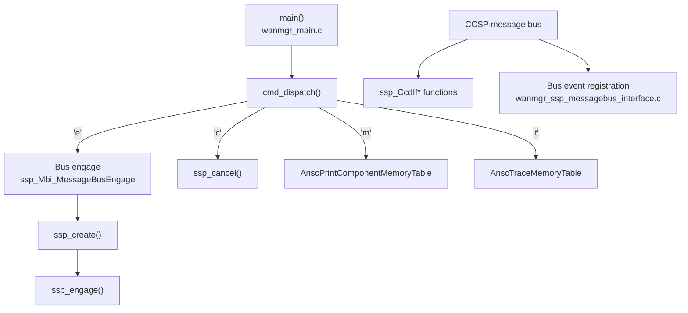
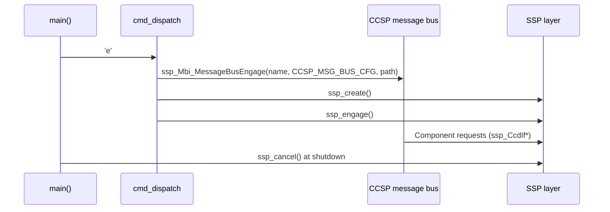

# SSP and Message Bus

## Overview

The SSP (Service Support Platform) layer connects WAN Manager to the CCSP message bus. It creates the component, registers it on the bus, and manages the component lifecycle: create, engage, and cancel. The layer also exposes the component management interface (`ssp_CcdIf*`) that the bus uses to query component name, version, health, state, logging settings, and memory usage.

Source files:

- `source/WanManager/wanmgr_main.c` (command dispatch and startup)
- `source/WanManager/wanmgr_ssp_action.c` (`ssp_create`, `ssp_engage`, `ssp_cancel`, component interface)
- `source/WanManager/wanmgr_ssp_messagebus_interface.c` (message bus event registration)
- `source/WanManager/wanmgr_ssp_global.h` (global SSP objects)
- `source/WanManager/wanmgr_ssp_internal.h` (component identifiers and paths)

---

## Architecture

---

## Component Identity

| Item | Value | Source |
| ---- | ----- | ------ |
| Component ID | `com.cisco.spvtg.ccsp.wanmanager` (`COMPONENT_ID_WANMANAGER`) | `wanmgr_ssp_internal.h` |
| Object path | `/com/cisco/spvtg/ccsp/wanmanager` (`COMPONENT_PATH_WANMANAGER`) | `wanmgr_ssp_internal.h` |
| Bus name | `eRT.com.cisco.spvtg.ccsp.wanmanager` (`WAN_COMPONENT_NAME`) | `wanmgr_ssp_internal.h` |

When WAN Manager runs with a subsystem prefix (`-subsys`), the component name is prefixed with that subsystem value before it is registered on the bus.

---

## Command Dispatch

`cmd_dispatch()` in `wanmgr_main.c` handles these commands:

| Command | Action |
| ------- | ------ |
| `e` | Connects to the message bus (`ssp_Mbi_MessageBusEngage`), then runs `ssp_create()` and `ssp_engage()` |
| `m` | Prints the component memory table (`AnscPrintComponentMemoryTable`) |
| `t` | Prints the trace memory table (`AnscTraceMemoryTable`) |
| `c` | Cancels the component (`ssp_cancel()`) |

At startup, `main()` calls `cmd_dispatch('e')` after the WAN data is initialised and before `Cdm_Init`. In foreground mode (`-c`), a command loop reads the same command characters from standard input. At shutdown, `main()` calls `ssp_cancel()`.

---

## Key Functions

### ssp_create

**Purpose:** Creates the SSP component objects for WAN Manager.

| | |
| - | - |
| **Inputs** | None |
| **Outputs** | `ANSC_STATUS` |

### ssp_engage

**Purpose:** Engages the component so it can serve requests on the bus.

| | |
| - | - |
| **Inputs** | None |
| **Outputs** | `ANSC_STATUS` |

### ssp_cancel

**Purpose:** Stops the component. It is also called when message bus registration fails (`wanmgr_ssp_messagebus_interface.c`).

| | |
| - | - |
| **Inputs** | None |
| **Outputs** | `ANSC_STATUS` |

### Component Management Interface (`ssp_CcdIf*`)

The CCD (component control) interface functions in `wanmgr_ssp_action.c` answer bus queries about the component:

| Function group | Purpose |
| -------------- | ------- |
| `ssp_CcdIfGetComponentName`, `ssp_CcdIfGetComponentVersion`, `ssp_CcdIfGetComponentAuthor` | Component identity |
| `ssp_CcdIfGetComponentHealth`, `ssp_CcdIfGetComponentState` | Component health and state |
| `ssp_CcdIfGetLoggingEnabled`, `ssp_CcdIfSetLoggingEnabled`, `ssp_CcdIfGetLoggingLevel`, `ssp_CcdIfSetLoggingLevel` | Logging control |
| `ssp_CcdIfGetMemMaxUsage`, `ssp_CcdIfGetMemMinUsage`, `ssp_CcdIfGetMemConsumed` | Memory usage |
| `ssp_CcdIfApplyChanges` | Applies pending configuration changes |

---

## Message Bus Events

`wanmgr_ssp_messagebus_interface.c` registers a bus event (`CurrentSessionIDSignal`) through `CcspBaseIf_Register_Event`. If the registration fails, the code logs the error and calls `ssp_cancel()`.

---

## Processing Flow

---

## Integration Points

### Dependencies

| Component | Usage |
| --------- | ----- |
| CCSP message bus (`ssp_Mbi_MessageBusEngage`, `CcspBaseIf_Register_Event`) | Component registration and events |
| Data model layer (`Cdm_Init`) | Data model initialisation, called after the bus engage step during startup. See [data-model-layer.md](data-model-layer.md) |

### Consumers

| Component | Usage |
| --------- | ----- |
| Bus clients | Query and configure WAN Manager through the registered component path |

---

## Error Handling

| Condition | Behaviour | Source |
| --------- | --------- | ------ |
| `Cdm_Init` fails | Error is printed and the process exits with status 1 | `wanmgr_main.c` |
| Bus event registration fails | Error is logged and `ssp_cancel()` is called | `wanmgr_ssp_messagebus_interface.c` |
